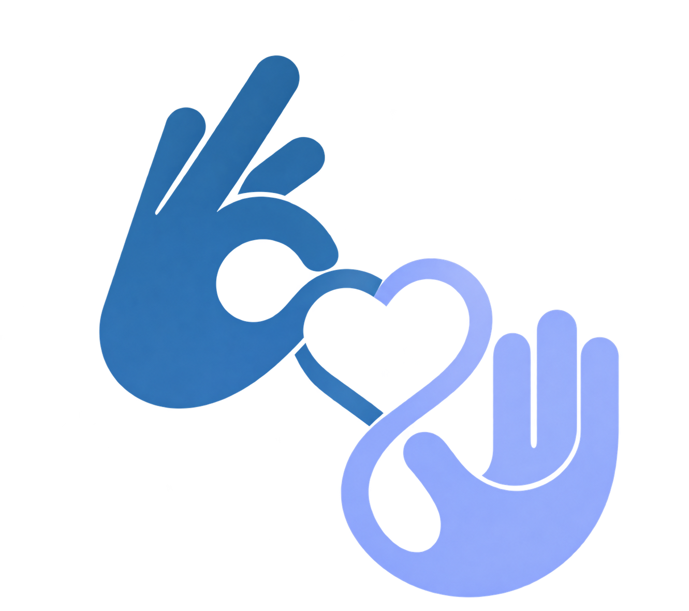
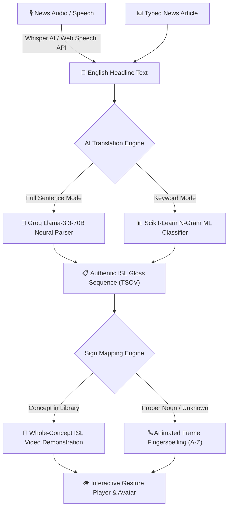

# 🤟 SIGNOVA (SAMVAAD) — News Without Barriers

<p align="center">
  
</p>

<p align="center">
  <strong>Real-Time AI News & Emergency Broadcast Translation into Indian Sign Language (ISL)</strong>
</p>

<p align="center">
  <a href="#-key-features"></a>
  <a href="#-tech-stack"></a>
  <a href="#-ai--linguistics-pipeline"></a>
  <a href="#-speech-to-sign"></a>
  <a href="#-theme--design-system"></a>
  <a href="#-license"></a>
</p>

---

## 📖 Overview

**SIGNOVA (SAMVAAD)** is a next-generation accessibility platform built to dismantle communication barriers for India's 18+ million Deaf and hard-of-hearing citizens.

Conventional television news and civic emergency broadcasts predominantly rely on audible sound or complex English/Hindi subtitles. However, Indian Sign Language (ISL) has its own distinct **Time-Location-Subject-Action (TSOV)** syntax, spatial orientation, and visual vocabulary. Direct literal English word substitutions fail to convey urgent meaning during disaster warnings and civic alerts.

SIGNOVA bridges this gap by combining:
1. **Live Speech & Audio Ingestion** (Whisper AI + Web Speech API).
2. **Neural Syntactic Parsing** converting complex English headlines into authentic ISL gloss order.
3. **Whole-Concept ISL Video & Motion Demonstrations** paired with alphabetical fingerspelling fallback.
4. **An Award-Winning Neo-Brutalist Soft Pastel UI/UX** designed with full accessibility and high-contrast dark mode.

---

## ✨ Key Features

### 🎙️ 1. Speech-to-Sign (Audio / Mic Ingestion)
- **Live Microphone Input:** One-tap voice capture using the browser's native Web Speech API with real-time interim speech recognition.
- **Audio File Broadcast Transcription:** Upload `.mp3`, `.wav`, `.m4a`, or `.ogg` news broadcasts processed through high-accuracy **Whisper Large v3** transcription.

### 🧠 2. Neural ISL Grammar Engine (TSOV Restructuring)
- **True Linguistic Restructuring:** Converts Subject-Verb-Object (SVO) English into ISL's native **Time — Location — Subject — Object — Verb (Action)** grammar.
- **Omission of Non-ISL Function Words:** Drops auxiliary verbs (*is*, *are*, *was*, *the*) and marks negative indicators at the sentence terminus.
- **Linguistic Grammar Explanations:** Explains the exact grammatical rules applied to each headline for educational transparency.

### 🎥 3. Whole-Concept Video Gestures (Beyond Fingerspelling)
- **Authentic Sign Demonstrations:** High-definition video and animation demonstrations for 20+ core disaster and emergency concepts (*Flood*, *Earthquake*, *Cyclone*, *Fire*, *Hospital*, *Police*, *Government*, *Evacuate*, *Shelter*, *Weather*, etc.).
- **Anatomical Sign Specifications:** Detailed breakdown of:
  - ✋ **Handshape** (e.g., Flat hand, 'G' index pointer, claw handshape).
  - 📍 **Body Location** (Chest, temple, neutral space, forehead).
  - 🧭 **Palm Orientation** (Inward, downward, opposing palms).
  - 🎭 **Non-Manual Markers** (Facial expressions, head movements, intensity markers).

### 🔍 4. Modal-Based Gesture Player
- **Zero Scroll Distraction:** Instant overlay modal opens directly over the concept card without forcing the user to scroll.
- **Interactive Playback Controls:** Play, pause, replay, and variable speed toggles (`0.5x`, `1.0x`, `1.5x`).
- **Seamless Fingerspelling Fallback:** Instant frame-by-frame 26-letter ISL avatar fingerspelling for proper nouns, names, and unmapped vocabulary.

### 📚 5. 54-Sign Comprehensive ISL Dictionary
- Searchable, filterable knowledge base categorized across **10 civic domains**:
  - 🌪️ *Disaster Alerts*
  - 🏥 *Healthcare & Medicine*
  - 🌦️ *Weather & Meteorology*
  - 🏛️ *Governance & Legal*
  - 🚌 *Transport & Railways*
  - 🚨 *Public Safety & Police*
  - 💧 *Civic Utilities & Water*
  - 🏫 *Education & Schools*
  - 💼 *Employment & Commerce*
  - 🗣️ *Daily Emergency Phrases*

### 🎨 6. Dribbble Neo-Brutalist Soft Pastel Design System
- **100% Fluid Full-Width Layout:** Eliminates constrained 90px margins for an immersive modern product look.
- **Top Horizontal Navbar:** Clean, responsive navigation bar with Framer Motion animated active pills and mobile drawer.
- **High-Contrast Dark Mode:** Carefully balanced semantic color tokens (`--btn-primary-*`, `--btn-secondary-*`, `--badge-*`) ensuring every button and label is fully readable in its default normal state without needing hover.

---

## 🏗️ Architecture & Pipeline



---

## 🛠️ Tech Stack

| Layer | Technologies |
| :--- | :--- |
| **Frontend Framework** | [React 18](https://react.dev/), [Vite 8](https://vitejs.dev/) |
| **Motion & Animation** | [Framer Motion](https://www.framer.com/motion/), CSS3 Custom Keyframes |
| **Styling & Design System** | Custom Neo-Brutalist CSS Variables, Plus Jakarta Sans |
| **Backend Server** | [Node.js](https://nodejs.org/), [Express](https://expressjs.com/), [Multer](https://github.com/expressjs/multer), [CORS](https://github.com/expressjs/cors) |
| **LLM & Speech AI** | [Groq Cloud SDK](https://groq.com/) (`Llama-3.3-70b-versatile`, `whisper-large-v3`) |
| **Machine Learning** | [Python 3](https://python.org/), [scikit-learn](https://scikit-learn.org/), [joblib](https://joblib.readthedocs.io/) |
| **Sign Asset Library** | Verified Indian Sign Language (ISL) handshape frames & demonstration media |

---

## 📁 Repository Structure

```text
SIGNOVA/
├── public/
│   ├── assets/
│   │   ├── alphabets/         # 0-9 and A-Z fingerspelling frames
│   │   ├── signing-poses/     # Anatomical avatar signing postures
│   │   └── samvaad_logo.png   # Official brand assets
│   └── videos/                # High-definition ISL gesture video captures
├── src/
│   ├── components/
│   │   ├── Navbar.jsx         # Horizontal top navigation with Theme toggle
│   │   ├── HomeLanding.jsx    # Dribbble hero showcase, bento cards & live demo
│   │   ├── NewsTranslator.jsx # Speech-to-sign workspace & TSOV inspector
│   │   ├── GestureModal.jsx   # Centered portal modal for ISL video playback
│   │   ├── SignDictionary.jsx # 54-sign searchable knowledge directory
│   │   ├── DetectedConcepts.jsx # Concept library table and card visualizer
│   │   ├── SigningAvatar.jsx  # Continuous frame-by-frame fingerspelling renderer
│   │   └── Working.jsx        # Interactive 4-step pipeline timeline
│   ├── context/
│   │   └── ThemeContext.jsx   # Light/Dark mode state with persistence
│   ├── data/
│   │   └── islConceptSigns.js # 20+ whole-concept gestures & anatomical definitions
│   ├── DribbbleTheme.css      # Neo-brutalist soft pastel design tokens
│   ├── App.jsx                # Main application orchestrator
│   └── main.jsx               # React entry point wrapped in ThemeProvider
├── ml_model/
│   ├── samvaad_word_model.joblib # Trained scikit-learn keyword classifier
│   ├── train_model.py         # Model training script
│   └── predict_model.py       # Node-to-Python bridge prediction script
├── server.js                  # Express backend (Whisper AI + Groq TSOV Parser)
├── package.json
└── vite.config.js
```

---

## 🚀 Getting Started

### Prerequisites
- **Node.js** `v18.0.0` or higher
- **npm** `v9.0.0` or higher
- **Python** `3.9+` *(optional, for running local ML retraining scripts)*
- A **Groq Cloud API Key** *(free at [console.groq.com](https://console.groq.com/))*

---

### Installation

1. **Clone the repository:**
   ```bash
   git clone https://github.com/bhumiiiii-06/SIGNOVA.git
   cd SIGNOVA
   ```

2. **Install frontend and backend dependencies:**
   ```bash
   npm install
   ```

3. **Configure Environment Variables:**
   Create a `.env` file in the project root:
   ```env
   PORT=3001
   GROQ_API_KEY=your_groq_api_key_here
   ```

---

### Running the Application

1. **Start the Express AI Backend Server:**
   ```bash
   node server.js
   ```
   *The server runs on `http://localhost:3001` providing Whisper transcription and Groq ISL parsing.*

2. **In a separate terminal, start the Vite Development Server:**
   ```bash
   npm run dev
   ```
   *Open your browser and navigate to `http://localhost:5173`.*

3. **Production Build:**
   ```bash
   npm run build
   npm run preview
   ```

---

## 🧪 Testing the Modules

| Module | How to Test | Expected Output |
| :--- | :--- | :--- |
| **Speech-to-Sign** | Click **"Start Live Voice"** on News Translator and say *"Heavy rain flood alert in Mumbai tomorrow"*. | Audio transcribes in real-time and restructures into `[TOMORROW, MUMBAI, HEAVY RAIN, FLOOD, ALERT]`. |
| **Whole Concept Gestures** | Go to **Sign Dictionary**, search *"Earthquake"* or *"Government"*, and click **"Watch Gesture"**. | Centered modal opens immediately with HD gesture video, handshape guides, and playback speed controls. |
| **ISL Grammar TSOV** | Input *"The police arrested the thief yesterday"* in Sentence Mode. | Output ISL Gloss: `[YESTERDAY, POLICE, THIEF, ARREST]`. Auxiliary words (*the*, *ed*) are pruned. |
| **Dark Mode Contrast** | Toggle the Sun/Moon icon in the navbar. | Theme transitions smoothly into midnight navy while maintaining crisp readability across all buttons and badges. |

---

## 🤝 Contributing

Contributions are warmly welcomed! To contribute:

1. **Fork** the repository.
2. Create a descriptive feature branch:
   ```bash
   git checkout -b feature/new-sign-gesture
   ```
3. Commit your changes:
   ```bash
   git commit -m "Add whole-sign gesture demonstration for AMBULANCE"
   ```
4. Push to the branch:
   ```bash
   git push origin feature/new-sign-gesture
   ```
5. Open a **Pull Request**.

---

## 📜 License

This project is licensed under the **MIT License** — feel free to use, modify, and distribute this platform to advance accessibility for the Deaf community.

---

<p align="center">
  Built with ❤️ for an accessible, barrier-free India 🇮🇳<br />
  <strong>SIGNOVA — News Without Barriers</strong>
</p>
