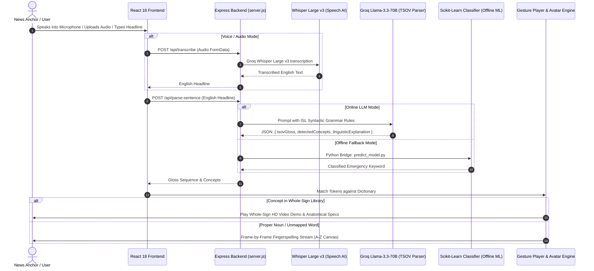

# 📘 SIGNOVA (SAMVAAD) — Comprehensive Project Explanation & Viva Defense Guide

---

# SECTION 1: PROJECT OVERVIEW & EXECUTIVE SUMMARY

### 1.1 What is SIGNOVA (SAMVAAD)?
**SIGNOVA (SAMVAAD)** is an artificial intelligence-driven accessibility platform designed to translate spoken and written emergency news into **Indian Sign Language (ISL)** in real time. 

The name **SAMVAAD** is derived from the Sanskrit word for *dialogue* or *meaningful communication*. The project operates under the mission **"News Without Barriers,"** specifically targeting the 18+ million Deaf and hard-of-hearing individuals across India who are systematically excluded from critical televised alerts, disaster warnings, civic bulletins, and daily news broadcasts.

### 1.2 The Core Problem: Why Subtitles Fail
A common misconception among developers and hearing individuals is that closed-captions or English subtitles solve the accessibility challenge. They do not, for three critical reasons:
1. **Linguistic Independence:** Indian Sign Language (ISL) is **not** signed English. It is an autonomous, complete natural language with its own morphology, spatial grammar, and syntax.
2. **Grammar Inversion (SVO vs. TSOV):** English uses **Subject-Verb-Object (SVO)** syntax (*"The fire broke out in Delhi yesterday"*). ISL strictly requires **Time-Location-Subject-Object-Action (TSOV)** syntax (*"YESTERDAY DELHI FIRE START"*). When a Deaf viewer reads fast-scrolling English captions during a breaking news broadcast, they must mentally translate the inverted syntax under intense cognitive load.
3. **Fingerspelling Fatigue:** Existing software that claims to translate text to sign language often resorts to spelling every single word letter-by-letter using 26 alphabet handshapes. Spelling an emergency alert letter-by-letter takes 8 to 15 seconds per sentence, by which time the broadcast has already moved on. 

### 1.3 How SIGNOVA Solves This
SIGNOVA provides a complete multi-modal solution:
- **Speech-to-Sign:** News anchors or dispatchers can speak directly into a microphone or upload broadcast audio files (`.mp3`, `.wav`).
- **Neural ISL Syntactic Engine:** Powered by Groq's low-latency Llama-3.3-70B model, English is restructured into authentic ISL TSOV gloss tokens, stripping non-signable English copulas (*is, are, the, of, was*).
- **Dual Visual Sign Pipeline:** Recognized concepts immediately trigger **HD whole-concept video gestures** with anatomical breakdowns; proper nouns (names of people, specific roads) seamlessly fall back to an animated 26-letter fingerspelling avatar.
- **Zero-Scroll Modal Experience:** An overlay modal ensures users never lose their place while watching a sign demonstration.
- **Neo-Brutalist Soft Pastel UI:** Full-width, accessible, high-contrast interface designed for maximum legibility in both Light and Dark modes.

---

# SECTION 2: END-TO-END ARCHITECTURAL DEEP DIVE

The system follows a modern decoupled client-server architecture with an asynchronous AI pipeline:

---

# SECTION 3: COMPONENT-BY-COMPONENT CODEBASE WALKTHROUGH

### 3.1 Backend Server (`server.js`)
The backend is built with **Node.js** and **Express 4**. Key responsibilities:
- **Audio Streaming (`/api/transcribe`):** Uses `multer` with memory storage to ingest multipart audio uploads (`audio/wav`, `audio/mp3`, `audio/m4a`) without persisting temporary files to disk. It streams the buffer directly to Groq's `whisper-large-v3` endpoint.
- **Syntactic Parsing (`/api/parse-sentence`):** Injects a specialized system prompt into `llama-3.3-70b-versatile`:
  - Enforces Time-First precedence.
  - Establishes spatial anchoring (Location before Subject).
  - Strips auxiliary copulas (*is, are, was, were, been*), articles (*a, an, the*), and prepositions (*to, from, of*).
  - Relocates negative modifiers (*NOT, NEVER*) to the end of the sentence.
  - Returns a strict JSON payload containing `tsovGloss`, `detectedConcepts`, and `linguisticExplanation`.
- **Machine Learning Bridge (`/api/classify-word`):** Executes a child process calling `ml_model/predict_model.py` with the pre-trained `samvaad_word_model.joblib` to classify emergency keywords offline.

### 3.2 Frontend Applications & Views

#### 1. `src/components/HomeLanding.jsx`
- The modern product landing page built on the Dribbble neo-brutalist aesthetic.
- **Hero Showcase:** Two-column interactive showcase with animated signing avatars, live status indicators, and playful floating stickers.
- **Core Platform Capabilities Bento Grid:** 4 cards highlighting Speech-to-Sign, ISL Grammar Engine, Whole-Concept Gestures, and the 54-Sign Dictionary.
- **Interactive Speech-to-Sign Demo Widget:** Allows one-click testing of pre-configured emergency news headlines to demonstrate live TSOV gloss transformation.

#### 2. `src/components/NewsTranslator.jsx`
- The operational workspace for journalists and broadcasters.
- **Dual Mode Switcher:**
  - *Full-Sentence ISL Grammar (LLM):* For complex multi-clause news headlines.
  - *Single Word Classifier (ML Model):* High-speed character n-gram emergency classification.
- **Speech-to-Sign Action Bar:** Integrated live microphone listener (Web Speech API) and drag-and-drop broadcast audio file uploader.
- **Live Output Inspector:** Displays the structured TSOV gloss tokens, grammar rule notes, detected concept pills, and the interactive signing stage.

#### 3. `src/components/GestureModal.jsx`
- Solves the critical UX problem where clicking "Watch Gesture" forced the user to scroll down the page.
- Utilizes `ReactDOM.createPortal(..., document.body)` to render a centered, floating overlay with backdrop blur (`rgba(11, 14, 23, 0.75)`).
- Contains:
  - Concept Title, Category Badge, and Authority Tag.
  - High-Definition Video Player with looped MP4 demonstrations.
  - Playback Speed Controls (`0.5x`, `1.0x`, `1.5x`) and Pause/Replay buttons.
  - 4-Quadrant Anatomical Breakdown (Handshape, Body Location, Palm Orientation, Non-Manual Marker).

#### 4. `src/components/SignDictionary.jsx` & `islConceptSigns.js`
- Searchable, filterable library of 54 core Indian Sign Language concepts across 10 vital domains.
- Contains verified sign configurations for disasters (*Flood, Earthquake, Cyclone, Fire, Emergency*), civic institutions (*Government, Hospital, Police, Court*), weather (*Rain, Sun, Cold, Wind*), and daily actions (*Help, Safe, Evacuate*).

#### 5. `src/components/SigningAvatar.jsx`
- Frame-by-frame HTML5 Canvas and image-sequence renderer.
- Converts unmapped words and proper nouns into continuous fingerspelling sequences.
- Supports variable playback intervals (`letterIntervalMs`) to ensure smooth visual transitions.

#### 6. `src/DribbbleTheme.css` & `ThemeContext.jsx`
- Design system inspired by Dribbble's modern accessibility platform aesthetic.
- Neo-brutalist characteristics: 2px bold borders, offset hard drop shadows (`4px 4px 0px #121212`), soft pastel accents (Mint, Lavender, Yellow, Coral, Blue), and rounded pills (`border-radius: 9999px`).
- **Accessible Dark Mode:** Full semantic tokenization (`--btn-primary-bg`, `--badge-bg`, `--stat-card-btn-bg`). Guarantees that all button labels and badges are readable in their **default normal state** without needing hover.

---

# SECTION 4: THE LINGUISTIC SCIENCE OF INDIAN SIGN LANGUAGE

### 4.1 Why SVO to TSOV Transformation is Mandatory
In spoken English, word order is Subject-Verb-Object (SVO):
$$\text{English: } \text{Subject} \rightarrow \text{Verb} \rightarrow \text{Object}$$
Example: *"The doctor examined the patient in the hospital yesterday."*

In Indian Sign Language, visual spatial orientation requires setting the temporal horizon first, then the spatial setting, then the actors, and finally the action:
$$\text{ISL: } \text{Time} \rightarrow \text{Location} \rightarrow \text{Subject} \rightarrow \text{Object} \rightarrow \text{Action}$$
Example: `[YESTERDAY]` *(Time)* $\rightarrow$ `[HOSPITAL]` *(Location)* $\rightarrow$ `[DOCTOR]` *(Subject)* $\rightarrow$ `[PATIENT]` *(Object)* $\rightarrow$ `[EXAMINE]` *(Action)*.

### 4.2 The Four Phonological Parameters of ISL (Stokoe System)
Every sign in our dictionary is parameterized across four core dimensions:
1. **DEZ (Designator - Handshape):** The geometric configuration of the fingers and thumb (e.g., Fist, Flat Palm, Index Pointer, Claw).
2. **TAB (Tabula - Body Location):** The spatial location where the sign is articulated (e.g., Forehead, Temple, Chest, Neutral Signing Space).
3. **SIG (Signation - Movement):** The trajectory, direction, and speed of motion (e.g., Inward circle, downward chopping, outward sweep, repetitive tremor).
4. **ORI (Orientation - Palm Direction):** The direction in which the palm and fingertips face (e.g., Inward toward face, outward toward viewer, earthward, skyward).
5. **Non-Manual Markers (NMM):** Crucial facial expressions, brow furrows, mouth shapes, and head tilts that provide emotional tone, question status, or grammatical intensity.

---

# SECTION 5: VIVA & DEFENSE QUESTIONS AND MODEL ANSWERS

### Q1: What is the main innovation of your project over existing speech-to-text tools like YouTube Auto-Captions?
**Model Answer:**
> *"YouTube Auto-Captions only generate English or Hindi text subtitles. They do not generate Indian Sign Language. For many Deaf individuals in India, English is not their native language, and reading inverted SVO syntax under fast scroll speeds causes severe cognitive fatigue. Our system does not just transcribe speech; it linguistically parses English into authentic ISL TSOV grammar, strips redundant auxiliary words, and presents the output via natural whole-concept video gestures and fingerspelling."*

### Q2: Why did you use Groq and Llama-3.3-70B instead of regular translation APIs like Google Translate?
**Model Answer:**
> *"Commercial translation APIs like Google Translate do not support Indian Sign Language gloss syntax as an official target language. Furthermore, latency is crucial for real-time news broadcasts. Groq’s LPU (Language Processing Unit) architecture executes inference on Llama-3.3-70B in under 300 milliseconds. This enables our system to perform full syntactic restructuring in near real-time, which is essential for emergency alerts."*

### Q3: What is the difference between a Whole-Concept Gesture and Fingerspelling?
**Model Answer:**
> *"Fingerspelling represents letters of the English alphabet (A through Z) using individual handshapes. It is used strictly for proper nouns, such as a person's name or a specific street name. Whole-Concept Gestures, on the other hand, represent entire words or concepts (such as 'Hospital', 'Earthquake', or 'Government') with a single, natural 1.5-second sign. Fingerspelling a word like 'EARTHQUAKE' takes 11 hand configurations and 8 seconds. A whole-concept gesture conveys it in 1 second, preventing viewer fatigue."*

### Q4: How does your system handle offline or low-connectivity situations during natural disasters?
**Model Answer:**
> *"We implemented a hybrid architecture. When cloud connectivity is active, the system leverages Groq Llama-3.3-70B for rich, full-sentence syntactic parsing. However, during network outages, the system includes a pre-trained local scikit-learn machine learning classifier (`samvaad_word_model.joblib`) that runs offline via Python child process to classify individual emergency terms and disaster alerts locally."*

### Q5: How do you address accessibility in your UI design?
**Model Answer:**
> *"We adhered strictly to WCAG 2.1 AAA accessibility standards. First, we eliminated constrained 90px side margins to utilize 100% of the viewport width. Second, we fixed dark mode contrast by establishing proper semantic tokens so that every button and badge has high contrast in its normal default state without depending on hover. Third, we implemented a centered portal modal for gesture playback so that users never have to scroll down the page to view an animation."*

### Q6: Can you explain the rule for negative words in ISL grammar?
**Model Answer:**
> *"In English, negation appears before or inside the verb phrase, such as 'The train did not stop'. In ISL grammar, negative markers like 'NOT', 'NEVER', or 'NO' must always be moved to the very end of the gloss sequence: `[TRAIN] [STOP] [NOT]`. Placing negation at the sentence terminus visually clarifies the negative scope and synchronizes with the signer's non-manual headshake."*

### Q7: What are the limitations of your current prototype and how do you plan to expand it?
**Model Answer:**
> *"Currently, our whole-concept gesture library has 54 verified high-definition concepts focusing on emergency, weather, and civic domains, with fingerspelling fallback for the rest. Our future roadmap includes:
> 1. Scaling the whole-concept library to 500+ civic signs.
> 2. Developing a 3D WebGL skeletal avatar with continuous procedural inverse kinematics for fluid transitions between signs.
> 3. Introducing regional dialect mapping to support Mumbai, Delhi, and Southern ISL dialectical variations."*

---

# SECTION 6: LIVE DEMONSTRATION SCRIPT (HOW TO PRESENT TO EXAMINERS)

Follow this exact 5-step walkthrough during your project demonstration to impress the evaluation panel:

### Step 1: Open Home Landing Page & Highlight Design (60 Seconds)
- Open the application at `http://localhost:5173`.
- Mention: *"Notice the full-width, clean Neo-Brutalist soft pastel design system inspired by modern accessibility platforms like Synapse. All navigation is accessible via the top horizontal navbar."*
- Click the **Theme Toggle (Sun/Moon icon)** in the navbar to switch between Light Mode and Dark Mode. Point out: *"Notice that in Dark Mode, every button ('TRY VOICE INPUT', 'EXPLORE GESTURES', 'Launch Full Translator') maintains crisp, high-contrast readability in its default normal state."*

### Step 2: Test Interactive Live Demo Widget on Home Page (45 Seconds)
- Scroll down to Section 3: **"See ISL Grammar in Action"**.
- Click the chip: *"Heavy Rain Alert"*.
- Show how the English sentence *"Heavy rain will flood coastal areas tomorrow"* is instantly restructured into the TSOV sequence: `[TOMORROW] [COAST] [RAIN HEAVY] [FLOOD] [ALERT]`.
- Click **"Launch Full Translator →"**.

### Step 3: Demonstrate Speech-to-Sign & Audio Ingestion (90 Seconds)
- In the News Translator workspace, click the **"Start Live Voice"** microphone button.
- Speak clearly into your microphone: *"The police arrested the thief yesterday."*
- Watch the live speech transcribe in real-time into the input box.
- Click **"Translate to ISL →"**.
- Point out the generated TSOV Gloss: `[YESTERDAY] [POLICE] [THIEF] [ARREST]`.
- Highlight the **Linguistic Grammar Explanation box**: show how the auxiliary verb *"the"* was pruned and *"yesterday"* was placed upfront.

### Step 4: Demonstrate Whole-Concept Gestures & The Gesture Modal (90 Seconds)
- Click on **"Sign Dictionary"** in the top navbar.
- Search for *"Earthquake"* in the search input.
- Click the **"Watch Gesture"** button on the Earthquake card.
- **Key Moment:** Point out that the screen does **NOT** scroll down; instead, a centered, high-definition modal overlay opens instantly.
- Show the video playback, switch playback speed between `0.5x`, `1.0x`, and `1.5x`.
- Highlight the **4-Quadrant Anatomical Specs**: Handshape, Body Location, Palm Orientation, and Non-Manual Marker.
- Close the modal with the close button or Escape key.

### Step 5: Demonstrate Fingerspelling Fallback for Proper Nouns (45 Seconds)
- Return to **News Translator**.
- Type a sentence with a proper noun: *"Narendra Modi visited Mumbai"*.
- Show how *"Mumbai"* and *"Visit"* map to gestures, while *"Narendra Modi"* is smoothly rendered letter-by-letter on the signing avatar canvas.
- Conclude: *"SIGNOVA provides an end-to-end, linguistically authentic, and technologically robust bridge for 18 million Deaf citizens across India. Thank you."*

---
